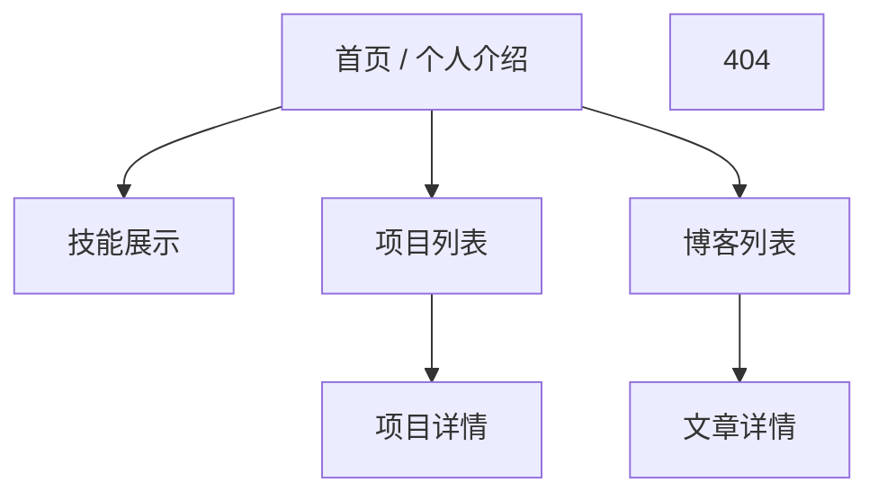

# 个人展示网站 · 产品需求文档（PRD）

> 版本：v1.0
> 日期：2026-10-18
> 状态：待评审

---

## 1. 项目概述

### 1.1 项目背景与目标

打造一个用于个人品牌展示的官方网站，集中呈现个人介绍、技能、项目与博客，向访客（招聘方、技术同行、潜在合作方）清晰传达「我是谁、我会什么、我做过什么、我在想什么」。

### 1.2 产品定位

- **一句话定位**：一个简洁、现代、带星空氛围的个人技术与思考展示空间。
- **核心关键词**：简洁、现代、深色、星空、多端适配。

### 1.3 目标用户与使用场景

| 用户类型 | 核心诉求 | 主要访问路径 |
| --- | --- | --- |
| 招聘方 / HR | 快速了解背景、技能与项目 | 首页 → 技能 → 项目 |
| 技术同行 | 阅读博客、交流技术观点 | 首页 → 博客 → 文章详情 |
| 潜在合作方 | 评估能力与过往作品 | 项目 → 关于/联系方式 |

### 1.4 产品目标

- 让访客在 3 秒内理解站长的定位与核心能力。
- 内容更新成本低：新增/修改简介、技能、项目、文章无需改代码。
- 全平台访问体验一致：桌面、平板、手机均可用。

---

## 2. 核心功能

### 2.1 全局功能（所有页面共有）

| 功能 | 说明 |
| --- | --- |
| 顶部导航 | 站点 Logo/姓名 + 主导航（首页/技能/项目/博客）。移动端折叠为汉堡菜单。 |
| 深色主题 | 全站默认深色主题，色彩统一，保证文字可读性。 |
| 星空背景 | 全站统一的星空视觉背景（详见 §4.3），作为氛围层，不干扰内容。 |
| 响应式布局 | 移动优先，桌面/平板/手机三端自适应（详见 §4.6）。 |
| SEO | 每个页面独立 title、description、Open Graph 元数据。 |
| 页脚 | 版权信息 + 社交/联系方式链接（GitHub、邮箱、微信公众号等）。 |
| 回到顶部 | 长页面提供「回到顶部」快捷按钮。 |

### 2.2 个人介绍（首页 / About）

- 头像、姓名、一句话定位（如「前端工程师 · 专注体验与工程化」）。
- 一段 100–200 字的个人简介。
- 关键亮点数据（如工作年限、项目数量、博客文章数），以简洁卡片呈现。
- 可选：职业/学习时间线（Timeline）。
- 快速入口按钮：跳转到「技能」「项目」「博客」，并提供联系入口。

### 2.3 技能展示（Skills）

- 技能按分组呈现（建议分组：前端 / 后端 / 工具与基础设施 / 其他）。
- 每个技能项包含：名称、熟练度（可视化展示）、简述。
- 熟练度可视化支持两种形态：进度条或星级，需保持视觉克制。
- 可选的顶部「技术标签云」，用于快速扫描常用技术栈。

### 2.4 项目展示（Projects）

- 项目以卡片网格呈现，每张卡片包含：
  - 封面图（或首屏截图，缺失时用优雅的占位图）
  - 项目名称、一句话描述
  - 技术栈标签
  - 链接（Demo / 源码）
- 支持按分类或技术栈筛选（前端/后端/开源等）。
- 点击进入项目详情页：完整描述、背景与挑战、技术选型、成果/亮点、截图、相关链接。

### 2.5 博客（Blog）

- **文章列表页**：
  - 按时间倒序排列，支持分页。
  - 每条显示：标题、摘要、发布日期、分类、标签、阅读时长。
  - 支持按分类/标签过滤。
- **文章详情页**：
  - Markdown 渲染（含代码块语法高亮、图片、表格、引用）。
  - 显示标题、作者、日期、阅读时长、分类/标签。
  - 上一篇 / 下一篇导航。
  - 可选：文章目录（TOC，长文自动生成侧边栏）。
- **内容管理**：本地 Markdown 文件 + frontmatter 元数据（title、date、summary、tags、category、cover），提交文件即发布（详见 §5.3）。

### 2.6 其他（可选，非 MVP 必做）

- 站内搜索（基于内容索引的前端搜索）。
- 访客统计 / 评论（第三方接入）。
- 多语言（中英切换）。
- RSS 订阅。

---

## 3. 页面结构与信息架构

### 3.1 站点地图

### 3.2 路由约定（Next.js App Router）

| 页面 | 路由 |
| --- | --- |
| 首页 / 个人介绍 | `/` |
| 技能展示 | `/skills` |
| 项目列表 | `/projects` |
| 项目详情 | `/projects/[slug]` |
| 博客列表 | `/blog` |
| 文章详情 | `/blog/[slug]` |
| 404 | 自定义 `not-found` |

---

## 4. 设计要点

### 4.1 视觉风格与原则

- **简洁现代**：大量留白、克制配色、清晰的视觉层级，避免过度装饰。
- **深色为主**：以深色背景为基础，营造静谧、专注的观感，同时衬托星空氛围。
- **内容优先**：动画与装饰只作为氛围层，不抢占内容注意力。
- 圆角、细描边、柔和阴影，保持现代质感。

### 4.2 色彩系统

| 用途 | 色值（建议） |
| --- | --- |
| 页面背景 | `#0B0F1A` ~ `#101527`（深蓝黑渐变） |
| 卡片/容器背景 | `#151B2E`（半透明 + 毛玻璃可选） |
| 主文字 | `#E6EAF2` |
| 次要文字 | `#9AA3B5` |
| 主色 / 强调色 | 星空蓝 `#5B8DEF` 或青蓝 `#38BDF8` |
| 点缀色（星点） | `#FFFFFF`、`#8FB3FF` |

> 具体色值在视觉稿阶段统一落到 Tailwind 设计令牌（design tokens），保持全站一致。

### 4.3 星空背景实现要点

- 采用 `<canvas>` 粒子方案（星点缓慢闪烁/漂移），或纯 CSS `box-shadow` 星点 + 缓慢动画。
- 星点数量与动画幅度需控制，避免影响性能（详见 §6.1）。
- 星点位于内容底层（`z-index` 最低），不影响交互与可读性。
- 支持 `prefers-reduced-motion`：用户开启「减少动态」时，停用或大幅降低动画。
- 可选：鼠标移动产生轻微视差（Parallax），作为氛围增强，桌面端默认关闭或低强度。

### 4.4 字体与排版

- 中文字体建议：系统字体栈 + 可选 Web 字体（如 `Noto Sans SC`）；英文/数字使用 `Inter` 等现代无衬线字体。
- 标题与正文层级清晰：H1/H2/H3 字号、字重区分明显。
- 正文行高 1.6–1.8，正文最大宽度（约 68–72 字符）保证长文可读性。
- 代码块使用等宽字体，深色高亮主题与全站风格一致。

### 4.5 组件与动效

- **入场动画**：页面进入/滚动到视口时，卡片淡入上移（fade + translate），时长 0.3–0.5s。
- **过渡反馈**：链接、卡片、按钮 hover 时轻微上浮/高亮，配合 `transition`。
- **导航**：滚动时顶部导航可加轻微半透明背景 + 毛玻璃。
- 所有动画遵循「克制、快、不打断」原则，并遵守 §4.3 的 reduced-motion 降级。

### 4.6 响应式设计（多端适配）

- 采用移动优先（Mobile First），断点建议：
  - 手机 `< 640px`
  - 平板 `640px – 1024px`
  - 桌面 `> 1024px`
- 布局差异：
  - 手机：单列布局，导航折叠为汉堡菜单，项目/博客卡片单列。
  - 平板：双列网格。
  - 桌面：多列网格 + 更宽的留白与更大字号。
- 触控目标不小于 44×44px，保证移动端可点性。

### 4.7 可访问性（A11y）

- 文字与背景对比度满足 WCAG AA（正文对比度 ≥ 4.5:1）。
- 全站支持键盘导航，焦点状态清晰可见。
- 图片提供 `alt` 文本，语义化 HTML 标签。
- 动效支持 `prefers-reduced-motion` 降级（同 §4.3）。

---

## 5. 技术方案与约束

### 5.1 技术栈

| 层级 | 选型 |
| --- | --- |
| 框架 | Next.js（App Router） |
| 语言 | TypeScript |
| UI | React + Tailwind CSS（可叠加 shadcn/ui 组件） |
| 内容渲染 | Markdown / MDX + 代码高亮（如 `shiki` / `rehype-pretty-code`） |
| 部署 | Vercel（推荐）或 `next build` 静态导出 |

### 5.2 目录与内容管理

- 个人数据（简介、技能、项目）与博客文章统一用**结构化数据文件**管理，便于无代码更新：
  - `content/about.md`（或 JSON）—— 个人简介、定位、亮点数据
  - `content/skills.json`（或 YAML）—— 技能分组与熟练度
  - `content/projects/*.md` —— 项目详情（frontmatter 存名称、技术栈、链接、封面）
  - `content/blog/*.md` —— 博客文章（frontmatter 存标题、日期、摘要、标签、分类、封面）

### 5.3 渲染策略

- 静态页面（首页、技能、项目、博客列表）采用 SSG，构建时生成。
- 博客与项目详情采用 SSG 或 ISR（新增文章后自动增量更新）。
- 保证首屏性能与 SEO，避免客户端渲染依赖内容。

---

## 6. 非功能需求

### 6.1 性能

| 指标 | 目标 |
| --- | --- |
| LCP（最大内容绘制） | < 2.5s |
| CLS（累计布局偏移） | < 0.1 |
| FCP（首次内容绘制） | < 1.8s |
| 首屏 JS 体积 | 尽量精简，星空动画不阻塞渲染 |

- 星空粒子数量与动画帧率需做移动端降级，避免低端机掉帧。

### 6.2 SEO

- 每个页面独立 `title` / `description` / Open Graph / 结构化数据（JSON-LD）。
- 生成 `sitemap.xml` 与 `robots.txt`。
- 博客文章支持规范链接与分享卡片（OG 图）。

### 6.3 可维护性

- 内容与代码分离，新增文章/项目无需改代码。
- 代码遵循统一规范（ESLint + Prettier），组件化组织。

---

## 7. 迭代计划

| 里程碑 | 范围 | 验收标准 |
| --- | --- | --- |
| M1 · MVP | 四大模块（介绍/技能/项目/博客）基础版 + 深色主题 + 星空背景 + 响应式 + SEO | 桌面与手机均可正常浏览，内容可静态渲染 |
| M2 · 完善 | 动效打磨、项目筛选、文章分类/标签、文章 TOC、站内搜索 | 交互流畅，长文阅读体验完善 |
| M3 · 增强 | 多语言、访客统计/评论、RSS、视差星空等 | 可选能力按需上线 |

---

## 附：待评审问题

1. 站点内容语言：中文为主，是否需要预留英文/双语切换？（当前默认中文，M3 可扩展）
2. 星空背景的强度与是否启用视差效果，需在视觉稿阶段确认。
3. 博客是否需要评论系统（涉及第三方接入与隐私）。
